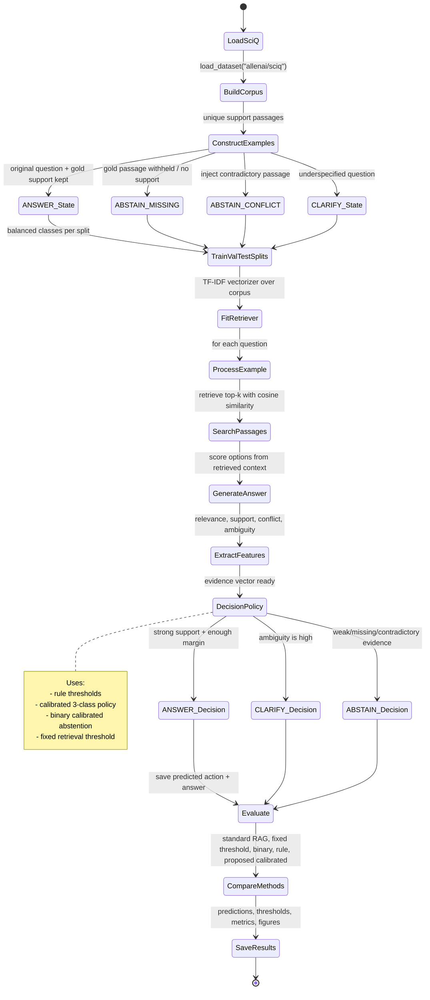

# State Diagram: Evidence-Calibrated Abstention in RAG

This project is a research pipeline for deciding whether a question should be answered, clarified, or abstained based on retrieval evidence.

## High-level state diagram

## Event-by-event working flow

### 1) Start: load the scientific dataset

Event: `load_dataset("allenai/sciq")`

- The project starts from the SciQ dataset, which contains science questions, answer options, and sometimes a supporting passage.
- The code imports this in the dataset construction step.
- The original SciQ dataset does not have explicit `ANSWER`, `CLARIFY`, and `ABSTAIN` labels, so those are created programmatically.

Relevant files:
- `src/dataset.py`
- `scripts/run_experiment.py`

### 2) Build the retrieval corpus

Event: `build_corpus()`

- All non-empty support texts from SciQ are normalized and deduplicated.
- A closed corpus of passages is created for retrieval.
- This is used as the knowledge base for the sparse retrieval model.

Important detail:
- The corpus is built from train + validation + test support paragraphs.
- This is intentionally a closed setup for research, not an open web retrieval system.

### 3) Construct gold actions

Event: `construct_split()`

The dataset builder creates four evidence scenarios:

- `ANSWER`
  - The question is normal.
  - The gold passage remains available in the corpus.
  - The system should answer.

- `ABSTAIN / missing`
  - Gold evidence is withheld or originally absent.
  - The question should not be answered confidently.

- `ABSTAIN / contradictory`
  - An injected passage states a distractor or conflicting answer.
  - This creates a contradiction that should prevent unsupported answering.

- `CLARIFY`
  - The question is underspecified, such as using pronouns like "this" or "it".
  - The system should ask for missing context instead of answering wrong.

The labels are used for evaluation and training. They are never treated as a source of truth for the retriever itself.

### 4) Fit the retriever

Event: `TfidfRetriever.fit()`

- The project uses TF-IDF with cosine similarity instead of dense embeddings.
- This is selected because the environment has no reliable PyTorch/FAISS setup for the original dense RAG approach.
- The retriever turns passages into TF-IDF vectors and ranks them according to query similarity.

Relevant file:
- `src/retrieve.py`

### 5) Process one example

Event: `process_example()`

For every example, the pipeline does the following:

1. Remove withheld passage IDs from search.
2. Optionally inject a conflict passage.
3. Search top-k passages using TF-IDF similarity.
4. Generate a candidate answer from the retrieved context.
5. Extract evidence features.
6. Return all metadata, retrieved passages, and feature values.

This is the core per-question state transition in the project.

Relevant file:
- `src/pipeline.py`

### 6) Retrieval and generation

Event: `retriever.search()` and `generate_answer()`

- The question is matched against the corpus.
- Top-k passages are returned.
- These passages are passed to a generation routine that estimates which option is best supported.
- The generator also exposes information such as:
  - predicted answer
  - option scores
  - extractive span
  - whether the answer is supported by context

### 7) Evidence extraction

Event: `extract_features()`

The project converts retrieved evidence into measurable signals. The main feature set is:

- `max_relevance`: strongest match score
- `mean_relevance`: average match strength
- `goldish_support`: whether the predicted answer appears in retrieved context
- `option_margin`: how much better one option scores than the others
- `conflict`: whether evidence supports incompatible answers
- `ambiguity`: whether the question is underspecified
- `retrieval_empty`: whether no useful evidence was found
- `n_hits`: number of retrieved passages

This state decides whether the evidence is actually sufficient or not.

Relevant file:
- `src/evidence.py`

### 8) Decision policy

Event: `rule_decide()` / `CalibratedPolicy.decide()` / `BinaryCalibratedAbstention.decide()`

The system can choose among multiple policies:

- Rule-based decision
  - if ambiguity is high → `CLARIFY`
  - if evidence conflicts strongly → `ABSTAIN`
  - if retrieval is weak or empty → `ABSTAIN`
  - if support and option margin are good → `ANSWER`

- Calibrated three-action policy
  - fits a probability model for `ANSWER`, `CLARIFY`, `ABSTAIN`
  - uses logistic regression + calibration

- Binary calibrated abstention
  - models `answerable` vs `not answerable`
  - decides whether to answer or abstain

- Fixed threshold policy
  - chooses `ANSWER` if max relevance exceeds a tuned threshold

### 9) Evaluation and comparison

Event: `summarize()` and `risk_coverage_curve()`

After deciding on all test examples, the project compares several methods:

- standard RAG always answers
- fixed threshold policy
- calibrated binary abstention
- rule-based three-action policy
- proposed calibrated three-action policy

It computes metrics such as:

- action accuracy
- unsupported-answer rate
- false abstention rate
- coverage
- selective risk
- citation hit rate
- Brier score / calibration error
- latency

It also produces plots for:

- confusion matrices
- reliability diagrams
- risk-coverage curves
- ablation studies

Relevant files:
- `src/evaluate.py`
- `src/plots.py`
- `scripts/run_experiment.py`

### 10) Save outputs

Event: `save_json()` and figure generation

The experiment writes outputs into the `results/` folder:

- `results/test_metrics.json`
- `results/predictions_standard_rag.json`
- `results/predictions_fixed_threshold.json`
- `results/predictions_calibrated_binary.json`
- `results/predictions_rule_three_action.json`
- `results/predictions_proposed_calibrated_three_action.json`
- `results/thresholds.json`
- `results/figures/`

These outputs are the final research artifacts of the pipeline.

## Simplified process summary

The project works in this sequence:

1. Read SciQ data
2. Build science passage corpus
3. Create synthetic `ANSWER`, `CLARIFY`, and `ABSTAIN` examples
4. Retrieve relevant passages
5. Generate answer candidates
6. Extract evidence signals
7. Apply a policy to decide action
8. Evaluate against gold labels
9. Save metrics and figures

## Core idea

The central idea is not “always answer with the best retrieval hit.”
Instead, the system asks:

- Is the question ambiguous?
- Is the evidence weak or empty?
- Is there conflict in the retrieved passages?
- Is the answer actually supported by the evidence?

Only then does it decide whether to answer, clarify, or abstain.

## One-line description

This project is a closed-set scientific RAG pipeline that uses retrieval evidence, calibration, and action-aware decision rules to reduce unsupported answers while preserving useful coverage.
